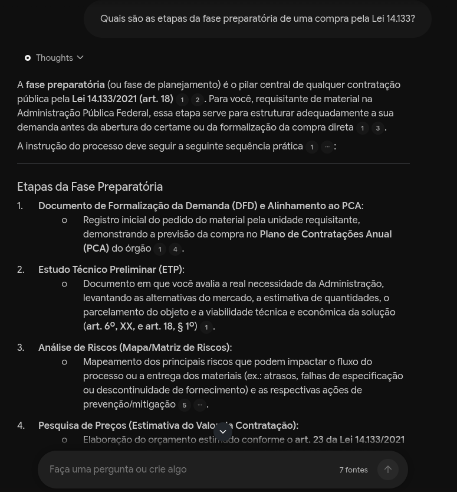
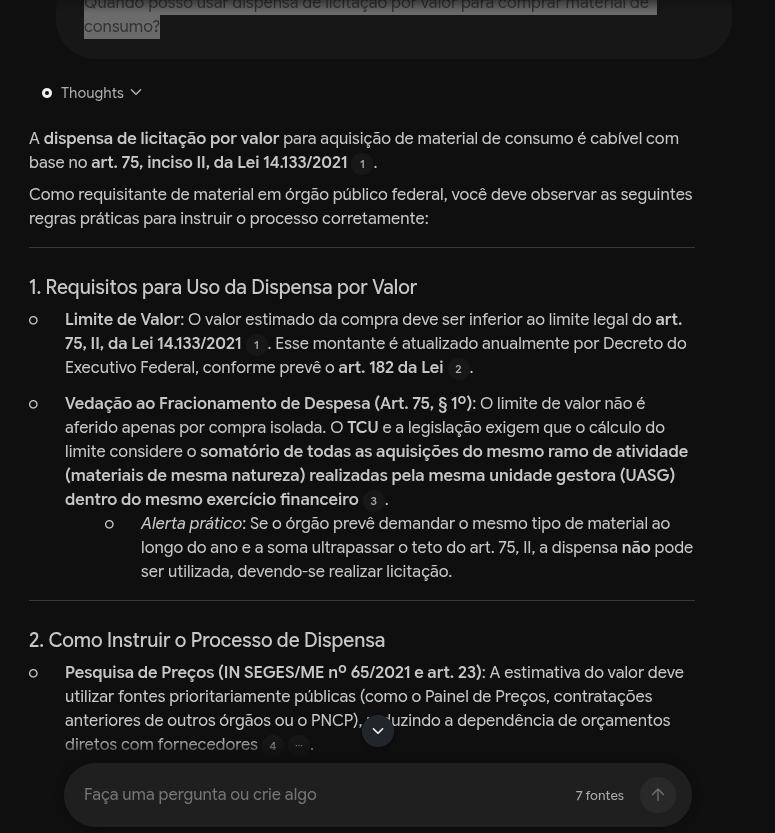
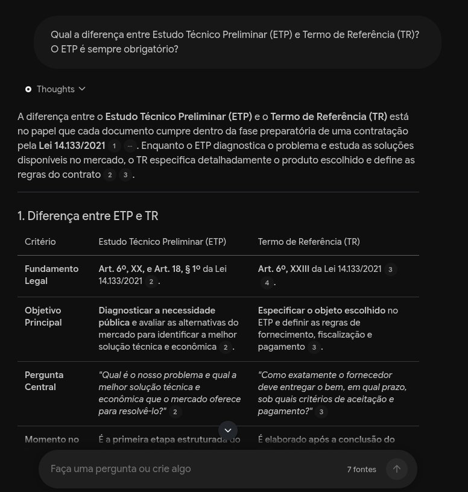
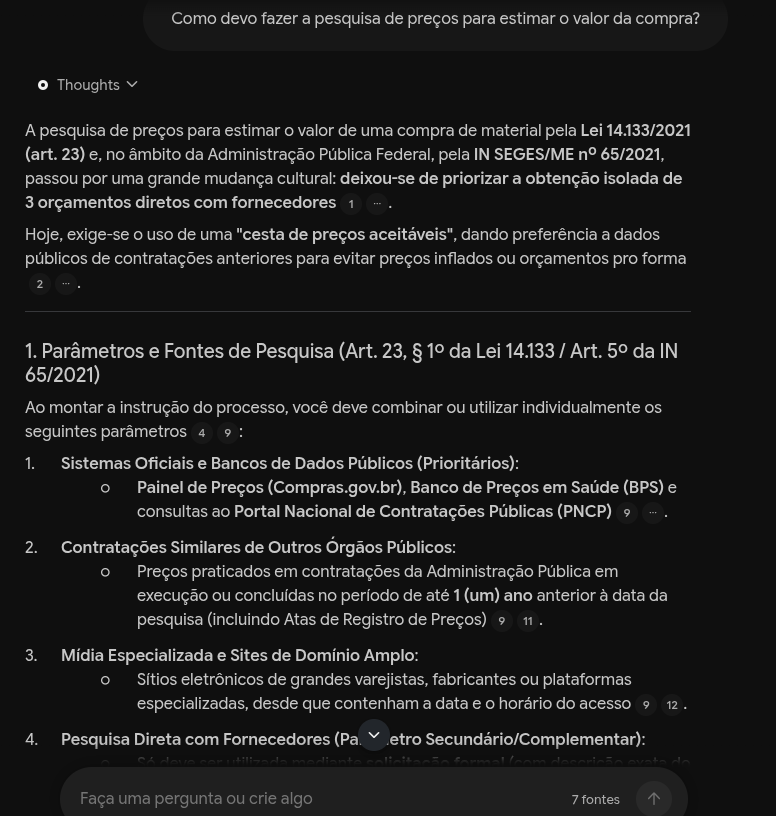
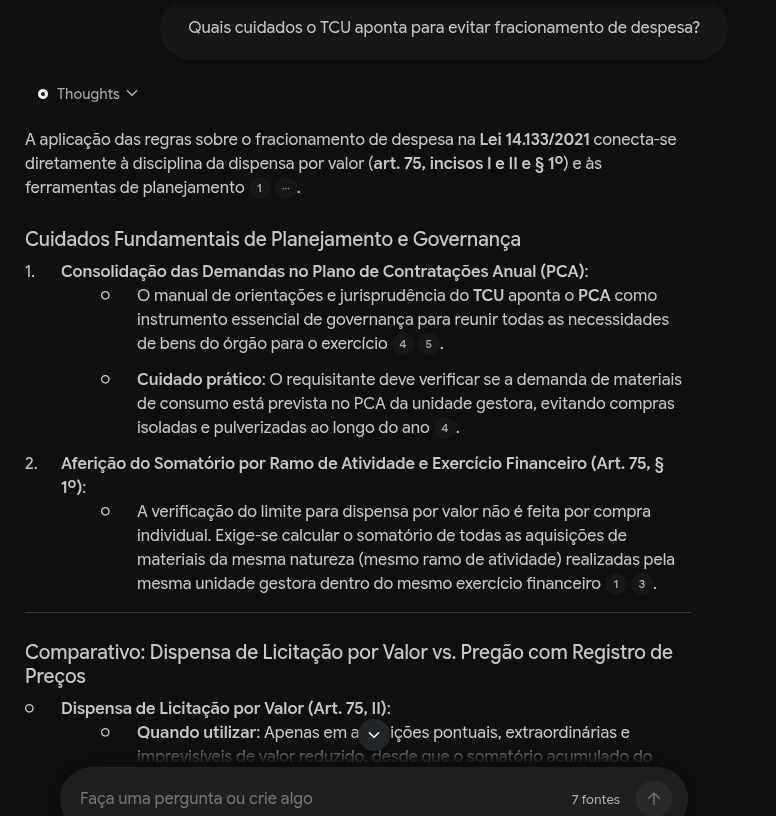
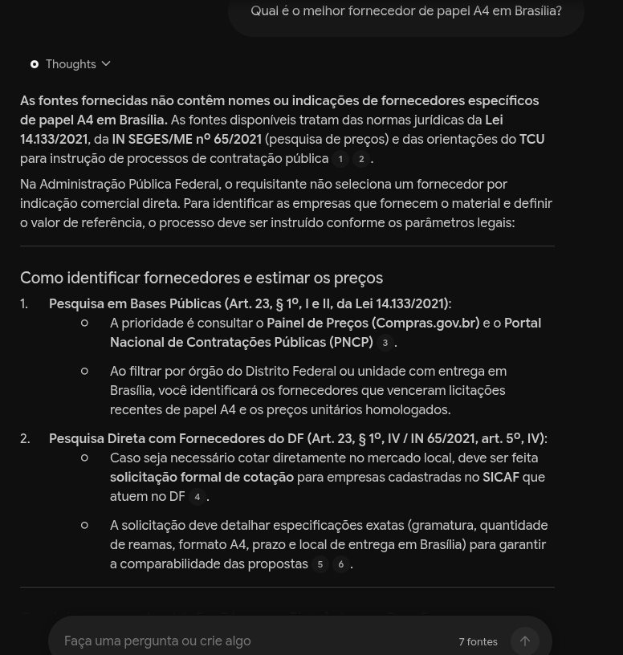

# 🧠 Segundo Cérebro: Nova Lei de Licitações (Lei 14.133/2021)

Notebook especialista em compras públicas, montado no **Gemini Notebook** (antigo NotebookLM) como parte do desafio de projeto da DIO.

## 🎯 Tema e objetivo

> **Quero um especialista na Lei 14.133/2021 que me ajude a fazer requisições de compra de material com segurança jurídica: saber qual caminho usar (dispensa, pregão, adesão a ata), quais documentos preparar (DFD, ETP, Termo de Referência) e onde a lei e o TCU fundamentam cada passo.**

**Por que esse tema:** desde 2024 faço requisições de compra de material numa unidade da administração pública, usando o Compras.gov.br e o Contratos.gov.br. A lei é longa, a jurisprudência é espalhada, e um erro de enquadramento atrasa a compra ou gera apontamento do controle. Um segundo cérebro que responde citando o artigo e a fonte resolve uma dor real do meu trabalho.

## 📚 Fontes e por que confio nelas

### Critérios de seleção

Antes de importar qualquer fonte, perguntei:

1. **Quem publicou?** Só entram órgãos oficiais (Câmara, TCU, AGU, MGI) e escolas de governo ou de contas.
2. **É fonte primária ou está perto dela?** Texto da lei e manuais oficiais têm prioridade sobre resumos de terceiros.
3. **Está atualizada para a Lei 14.133?** Material baseado só na Lei 8.666/1993 ficou de fora, porque ela foi revogada.
4. **Consigo conferir?** A fonte precisa citar artigos, acórdãos ou normas que eu possa checar.

### Fontes que entraram (7)

| # | Fonte (nome no notebook) | Formato | Por que confio |
|---|--------------------------|---------|----------------|
| 1 | **Lei de Licitações e Contratos Administrativos (2021) – Portal da Câmara dos Deputados** | Site | Texto da própria lei, publicado pela Câmara. É a fonte primária. |
| 2 | **[Licitações e Contratos](https://licitacoesecontratos.tcu.gov.br/)** (manual interativo do TCU) | Site | Versão on-line do Manual de Licitações e Contratos do TCU, atualizada pelo próprio Tribunal. |
| 3 | **[Licitações e Contratos: Orientações e Jurisprudência do TCU](https://portal.tcu.gov.br/publicacoes-institucionais/cartilha-manual-ou-tutorial/licitacoes-e-contratos-orientacoes-e-jurisprudencia-do-tcu)** | Site | Página oficial do manual (5ª ed.), do órgão que controla as compras federais. |
| 4 | **[Advocacia-Geral da União – modelos da Lei 14.133](https://www.gov.br/agu/pt-br/comunicacao/noticias/agu-e-ministerio-da-gestao-e-inovacao-em-servicos-publicos-disponibilizam-novos-modelos-de-licitacoes-e-contratos-da-lei-no-14-133-2021)** | Site | Modelos de edital, TR e contrato padronizados pela AGU com a SEGES/MGI. |
| 5 | **[Portal de Compras do Governo Federal](https://www.gov.br/compras/pt-br)** | Site | Portal oficial do sistema que uso no trabalho. |
| 6 | **[Programa de Capacitação sobre a NLLC – Aula 1: Pesquisa de Preços](https://www.youtube.com/watch?v=KiJ9ZpfJ9-s)**, canal Escola de Contas Públicas / TCE-ES (2022) | YouTube | Aula de escola de contas, indicada na trilha de aprendizagem oficial do TCE-ES sobre a Lei 14.133. |
| 7 | **[Contratação Direta – Oficina para simulação de uso do Sistema Compras.gov.br](https://www.youtube.com/watch?v=5ocjCjC48zQ)**, canal Escola de Governo do Estado de São Paulo – EGESP (2023) | YouTube | Oficina prática no mesmo sistema que uso, feita por escola de governo e indicada em tutorial da USP. |

> Conferi título, canal e data de cada vídeo antes de importar.

### O que não deu certo e como resolvi

- **Planalto:** o link da lei no site do Planalto falhou duas vezes na importação (o site bloqueia leitura automática). Troquei pela cópia oficial da lei no portal da Câmara.
- **PDF do Senado:** a edição da lei em PDF do Senado importou só uma tela de "verificação de segurança". Removi a fonte, porque ela não tinha conteúdo.

### Fontes descartadas na busca de fontes do notebook

A busca na web do notebook sugeriu 10 fontes para "texto integral da Lei 14.133". Importei só a da Câmara (a do Planalto falhou) e descartei o resto:

| Fonte sugerida | Por que ficou de fora |
|----------------|-----------------------|
| Lei 14.133 no DOU (Imprensa Nacional) | É o texto original de 2021, sem as alterações posteriores. |
| LexML Brasil | Só reúne links para outras publicações; o conteúdo já estava em outra fonte. |
| Base Legislação da Presidência | Duplicaria o texto da lei. |
| Orientações da Prefeitura de São Paulo | Regulamentação municipal, que não se aplica a órgão federal. |
| Manual do TCU (repetido) | Já estava no notebook. |
| Livro digital da Câmara com debates sobre a lei | Material de opinião e debate, não norma nem orientação oficial. |

## 🧭 Diretriz de comportamento

Configurei em **Configurar as conversas → Personalizado**:

```
Comporte-se como um especialista em contratações públicas pela Lei 14.133/2021,
com experiência em compras de material para órgãos da administração federal.
Responda em português, de forma direta e prática, como quem orienta um
requisitante que precisa montar o processo. Sempre indique o artigo da lei e,
quando houver, o entendimento do TCU ou o modelo da AGU que fundamenta a
resposta. Se as fontes não cobrirem a pergunta, diga isso claramente em vez de
supor. Quando houver mais de um caminho possível (ex.: dispensa x pregão),
compare os dois e diga em que situação cada um se aplica. Não use regras da
Lei 8.666/1993 como se ainda estivessem em vigor.
```

## 💬 Perguntas, respostas e fontes

Os números entre parênteses mostram quantas vezes cada fonte foi citada na resposta. Os prints estão em [`prints/`](prints/).

### 1. Quais são as etapas da fase preparatória de uma compra pela Lei 14.133?

- **Resposta (resumo):** a fase preparatória é o planejamento da compra (art. 18). A sequência prática é: DFD alinhado ao Plano de Contratações Anual, Estudo Técnico Preliminar (art. 6º, XX e art. 18, § 1º), análise de riscos, pesquisa de preços (art. 23 e IN SEGES/ME 65/2021, priorizando bases públicas como Painel de Preços e PNCP) e Termo de Referência (art. 6º, XXIII).
- **Fontes citadas:** manual interativo do TCU (12), aula de Pesquisa de Preços do TCE-ES (6), oficina de Contratação Direta da EGESP (3), página do manual do TCU (1), Portal de Compras (1).
- **Print:** 

### 2. Quando posso usar dispensa de licitação por valor para comprar material de consumo?

- **Resposta (resumo):** com base no art. 75, II, quando o valor estimado fica abaixo do limite legal, que é atualizado todo ano por decreto (art. 182). O limite não vale por compra isolada: soma-se tudo do mesmo ramo de atividade comprado pela mesma unidade gestora no exercício (art. 75, § 1º), para evitar fracionamento.
- **Fontes citadas:** oficina de Contratação Direta da EGESP (14), manual interativo do TCU (3), aula de Pesquisa de Preços do TCE-ES (2), Lei 14.133 na Câmara (1).
- **Print:** 

### 3. Qual a diferença entre Estudo Técnico Preliminar (ETP) e Termo de Referência (TR)? O ETP é sempre obrigatório?

- **Resposta (resumo):** o ETP avalia se e como contratar; o TR define as regras do fornecimento. O ETP é a regra (art. 18), mas pode ser dispensado em dispensa por valor (art. 75, I e II), em emergência (art. 75, VIII), em prorrogações e na contratação de remanescente (art. 90, § 7º). No pregão, ETP e TR são obrigatórios; na dispensa por valor, o fluxo simplificado é DFD → pesquisa de preços → TR simplificado → aviso no Compras.gov.br / PNCP.
- **Fontes citadas:** aula de Pesquisa de Preços do TCE-ES (2), oficina de Contratação Direta da EGESP (2), manual interativo do TCU (1), Lei 14.133 na Câmara (1).
- **Observação:** a resposta menciona a IN SEGES/ME 58/2021, que não está entre as fontes do notebook. Conferindo as citações, esse trecho não aponta para nenhuma fonte, então registro isso como um ponto a verificar fora do notebook.
- **Print:** 

### 4. Como devo fazer a pesquisa de preços para estimar o valor da compra?

- **Resposta (resumo):** pelo art. 23 e pela IN SEGES/ME 65/2021, não se trabalha mais com "3 orçamentos" isolados, e sim com uma cesta de preços. Têm prioridade os sistemas oficiais (Painel de Preços, PNCP) e as contratações similares de outros órgãos; a cotação direta com fornecedores vem depois.
- **Fontes citadas:** aula de Pesquisa de Preços do TCE-ES (28), oficina de Contratação Direta da EGESP (1).
- **Print:** 

### 5. Quais cuidados o TCU aponta para evitar fracionamento de despesa?

- **Resposta (resumo):** reunir as demandas do ano no Plano de Contratações Anual, como recomenda o manual do TCU, para evitar compras pulverizadas, e calcular o limite da dispensa somando todas as compras do mesmo ramo de atividade na unidade gestora durante o exercício (art. 75, § 1º).
- **Fontes citadas:** manual interativo do TCU (10), Lei 14.133 na Câmara (4).
- **Print:** 

### 6. (Teste de limite) Qual é o melhor fornecedor de papel A4 em Brasília?

- **Objetivo:** ver se o notebook admite quando a resposta não está nas fontes.
- **Resposta (resumo):** o notebook disse que as fontes não indicam fornecedores específicos e explicou que, na administração pública, o fornecedor não é escolhido por indicação. Em seguida, mostrou como identificar fornecedores pela pesquisa de preços: Painel de Preços, PNCP e cotação formal com empresas cadastradas no SICAF.
- **Fontes citadas:** aula de Pesquisa de Preços do TCE-ES (2).
- **Conclusão:** a diretriz "diga quando as fontes não cobrirem" funcionou.
- **Print:** 

## 🎨 Materiais gerados no Estúdio

| Material | Arquivo |
|----------|---------|
| Mapa mental ("Compras Públicas Mapa Mental") | [`materiais/mapa-mental.png`](materiais/mapa-mental.png) |
| Guia de estudos ("Guia de Estudo: Licitações, Contratação Direta e Sistemas de Compras Públicas") | [`materiais/guia-de-estudos.pdf`](materiais/guia-de-estudos.pdf) |
| Apresentação de slides | [`materiais/slides.pdf`](materiais/slides.pdf) |

## 🔗 Notebook compartilhado

👉 **[Acessar o notebook](https://notebook.google.com/notebook/785da649-2abe-40d6-bf87-0c0124716b65)**

## 📝 O que aprendi

- **A IA só é tão boa quanto as fontes.** Na pergunta sobre pesquisa de preços, quase todas as citações vieram da aula do TCE-ES. Sem esse vídeo, a resposta teria pouca base.
- **Nem todo link oficial importa bem.** O Planalto e o PDF do Senado falharam, e só percebi porque olhei o que cada fonte trazia de fato.
- **Clicar nas citações é obrigatório.** Foi assim que vi que a menção à IN 58/2021 não tinha fonte por trás.
- **O teste de limite mostra se a diretriz funciona.** O notebook recusou inventar um fornecedor.

## 📁 Estrutura do repositório

```
segundo-cerebro-lei-14133/
├── README.md
├── materiais/
│   ├── mapa-mental.png
│   ├── guia-de-estudos.pdf
│   └── slides.pdf
└── prints/
    ├── pergunta-1.png
    ├── pergunta-2.png
    ├── pergunta-3.png
    ├── pergunta-4.png
    ├── pergunta-5.png
    └── pergunta-6.png
```

---

Feito por **Amon César Torres de Araújo** · Desafio DIO: Segundo Cérebro com IA
